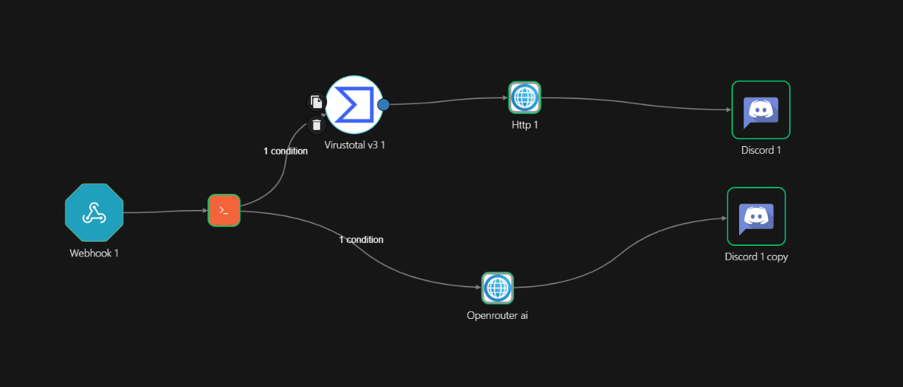
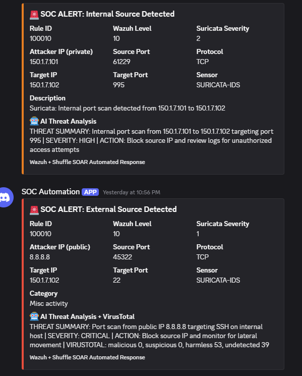
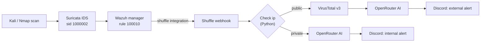

# 🛡️ AI-Assisted SOC Automation Lab

### Suricata → Wazuh → Shuffle SOAR → VirusTotal → AI Analysis → Discord


A self-hosted, isolated home lab that **detects a network port scan, enriches the alert automatically, adds a one-line AI analysis, and delivers it to Discord with no manual steps.**

> Built for learning detection engineering and SOC automation. Lab use only: run scans only against systems you own.

---

## ✨ What's new in v2.0

| | v1.0 | v2.0 |
|---|---|---|
| Detection | Wazuh + Suricata | Custom Suricata signature (sid 1000002) → custom Wazuh rule **100010** |
| Forwarding | All alerts at level 7+ | **Only rule 100010** reaches Shuffle (no floods) |
| Routing | Regex subnet filter | **Check ip** Python node: public vs private, with your own internal ranges |
| Enrichment | VirusTotal | VirusTotal for public sources, **AI analysis for every alert** |
| Output | One Discord format | Separate **internal** and **external** Discord alerts |

The original v1 build (including Wazuh Active Response) is preserved in [`docs/v1-setup-guide.md`](docs/v1-setup-guide.md).

---

## 📸 Demo

**Workflow in Shuffle**



**Alerts delivered to Discord** (internal source on top, public source below)



Each alert includes the rule ID, Wazuh level, Suricata severity, attacker IP, ports, protocol, target, sensor and a one-line AI result in the form:

```
THREAT SUMMARY: ... | SEVERITY: HIGH | ACTION: ...
```

Public-source alerts also carry the VirusTotal counts (`malicious`, `suspicious`, `harmless`, `undetected`).

---

## 🏗️ Architecture



### How it works

1. Nmap from the attacker VM triggers the custom Suricata signature (**sid 1000002**).
2. Wazuh decodes the Suricata event (built-in rule 86601); custom rule **100010** matches that signature at level 10.
3. Wazuh's `shuffle` integration forwards **only rule 100010** to the Shuffle webhook.
4. **Check ip** classifies the source as `private` or `public`.
5. **Public:** VirusTotal lookup → AI analysis (with the VirusTotal stats) → Discord.
6. **Private:** AI analysis → Discord. No VirusTotal call, which saves the free-tier quota.

---

## 🧰 Stack

| Layer | Tool |
|---|---|
| Network detection | Suricata |
| SIEM | Wazuh |
| SOAR | Shuffle |
| Threat intelligence | VirusTotal API v3 (free tier) |
| AI analysis | OpenRouter free models (fallback list of 3) |
| Notifications | Discord webhooks (embeds) |

---

## 📁 Repository layout

```
.
├── README.md
├── docs/
│   ├── v1-setup-guide.md        # Original step-by-step build (Shuffle install, Active Response)
│   └── images/
├── shuffle/
│   ├── v1/WAZUH-IR.json         # v1 workflow export (secrets removed)
│   └── v2/
│       ├── check_ip.py                      # public/private classifier
│       ├── openrouter_private_body.json     # AI request, internal path
│       ├── openrouter_public_body.json      # AI request, public path (+ VirusTotal stats)
│       ├── discord_private_body.json
│       └── discord_public_body.json
├── wazuh/
│   ├── local_rules.xml          # custom rule 100010
│   └── ossec-integration.xml    # shuffle integration block
└── suricata/
    └── threshold.config.example # stops the alert feedback loop
```

---

## 🚀 Quick start

Prerequisites: Suricata sensor with a Wazuh agent, Wazuh manager, Shuffle server, a VirusTotal API key, an OpenRouter API key, and a Discord webhook.

1. **Install Shuffle and create the webhook.** Follow Parts 1–2 of the [v1 guide](docs/v1-setup-guide.md).
2. **Add the custom Suricata signature** with `sid:1000002` and reload Suricata.
3. **Add the Wazuh rule.** Copy [`wazuh/local_rules.xml`](wazuh/local_rules.xml) into `/var/ossec/etc/rules/local_rules.xml`, then test with `wazuh-analysisd -t`.
4. **Add the integration block.** Use [`wazuh/ossec-integration.xml`](wazuh/ossec-integration.xml) in `/var/ossec/etc/ossec.conf` with your own webhook URL, then restart `wazuh-manager`.
5. **Build the Shuffle workflow** using the files in [`shuffle/v2/`](shuffle/v2/):
   - **Check ip** (Execute python) ← `check_ip.py`, then edit `MY_INTERNAL_RANGES` for your lab.
   - Arrow conditions: `$check_ip.message` **equals** `public` (to VirusTotal) and **equals** `private` (to the private AI node).
   - **VirusTotal** node: IP = `$exec.all_fields.data.src_ip`.
   - **HTTP** nodes: POST to `https://openrouter.ai/api/v1/chat/completions` with the matching body file, header `Authorization: Bearer <your key>`, timeout 120 s.
   - **Discord** nodes: POST the matching Discord body to your webhook.
6. **Suppress the feedback loop** (see below), then run `nmap` from the attacker VM and watch Discord.

---

## 💡 Lessons learned

- **Rule IDs are a chain.** Suricata sid → Wazuh parent rule 86601 → custom rule 100010 → integration filter. If any link is off, nothing reaches the SOAR.
- **Stop feedback loops.** Suricata alerted on Wazuh's own traffic to Shuffle. A `threshold.config` suppress for that signature fixed the flood.
- **A missing `$` silently skips nodes.** Shuffle conditions need `$check_ip.message`, not `check_ip.message`.
- **"Test action" is not a real run.** It uses unsaved editor code; the webhook runs the last saved workflow.
- **Reasoning models need token headroom.** Too low a `max_tokens` returns empty AI output.
- **Keep Discord JSON valid.** The AI prompt restricts output characters so quotes never break the embed.
- **A lab range can look public.** `150.1.7.0/24` is publicly routable, so internal ranges are listed explicitly in the classifier.

---

## ⚠️ Limitations

- Alerts on **one** Suricata signature; slow scans or non-matching traffic may not trigger it.
- Free tiers: VirusTotal allows about 4 lookups per minute; OpenRouter free models are rate-limited and can take close to a minute to answer.
- AI output is **advisory**, not a verdict.

## 🗺️ Roadmap

- [ ] Send the alert first and the AI analysis as a follow-up message to cut latency
- [ ] Alert deduplication and throttling per source IP
- [ ] VirusTotal result caching
- [ ] More Suricata signatures and Wazuh rules
- [ ] Automated setup script

---

## 🔐 Security notes

- **Never commit API keys or webhook URLs.** Every config in this repo uses placeholders such as `YOUR_WEBHOOK_URL`; rotate anything that was ever published.
- Shuffle workflow exports can embed webhook URLs. Review and sanitize an export before committing it.
- Do not send real or sensitive organisational data to free AI endpoints. Use lab data only.

---

## 🤝 Contributing

Issues and pull requests are welcome: fork, create a branch (`git checkout -b feature/your-idea`), commit, and open a PR.

## 📄 License

Released under the **MIT License**. See [LICENSE](LICENSE).

## 🙏 Acknowledgments

[Suricata](https://suricata.io) · [Wazuh](https://wazuh.com) · [Shuffle](https://shuffler.io) · [VirusTotal](https://virustotal.com) · [OpenRouter](https://openrouter.ai) · [Discord](https://discord.com)

---

<div align="center">

**Built by [@tayyab5608](https://github.com/tayyab5608) while learning cybersecurity and AI**

⭐ If this lab helped you, consider starring the repo.

</div>
